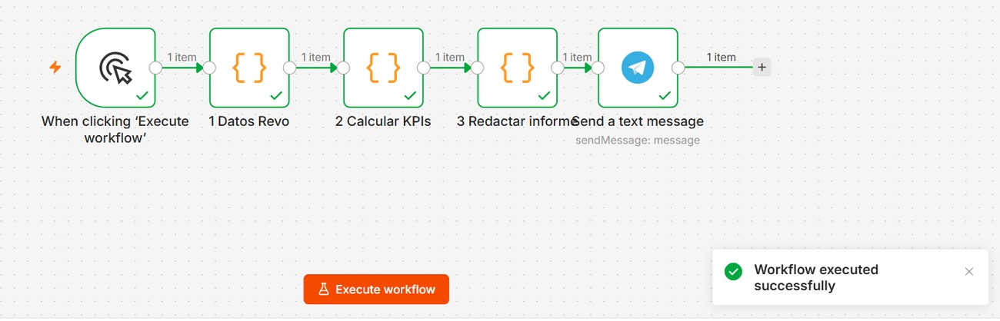
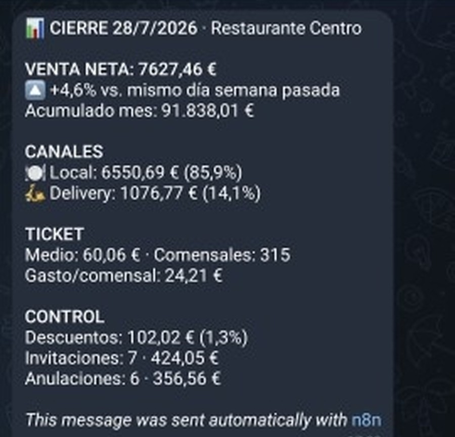

# n8n · Daily POS close report → Telegram

An n8n workflow that turns yesterday's point-of-sale tickets into the report a
restaurant manager actually reads: net sales against the same day last week,
channel split, average ticket, spend per cover, and the **control block**
(discounts, comps and voided tickets), delivered to Telegram before the morning
meeting.

## Why

In multi-site restaurants the day's figures are usually collected by hand:
someone opens the POS back office, copies numbers into a spreadsheet and pastes
a summary into a group chat. It takes time every morning, it arrives late on
busy days, and it almost never includes discounts, comps or voids, which is
where margin quietly leaves.

I built this flow at work to remove that manual step. This repository is a
clean reproduction of it: the same logic and the same message, with the
company's POS connection replaced by a node that generates **synthetic
tickets**, so anyone can import it and run it without credentials.

## What the workflow does

| Node | Type | Job |
|---|---|---|
| Trigger | Manual (Schedule in production) | Starts the run |
| 1 · POS data | Code | Produces the day's tickets. Swap it for an HTTP Request node against your POS API |
| 2 · Compute KPIs | Code | Net sales, week-on-week change, local vs delivery, average ticket, covers, spend per cover, discounts, comps and voids, in euros and as a share of sales |
| 3 · Write report | Code | Formats the Telegram message in Markdown |
| Telegram | Telegram | Sends it to the management chat |

## The lesson that shaped it

The first version fired at a fixed time. Some nights the till had not closed
the day yet, so the report went out missing the last tables and **nobody
noticed**, because a report that looks complete gets trusted.

The fix: trigger against the POS's actual close status, retry at spaced
intervals up to a cut-off time, and if the day is still open, send a warning
instead of the report. An automated report is only worth having if it knows
when to stay quiet. I don't consider a process automated until its output has
been checked against the source data.

## Run it

1. In n8n: **Workflows → Import from file** → `workflows/informe-cierre-diario.json`.
2. Create a Telegram bot with @BotFather, add a *Telegram API* credential in n8n
   and attach it to the Telegram node.
3. Set the environment variable `TELEGRAM_CHAT_ID` (or type the chat id in the node).
4. Execute the workflow. For daily use, replace the manual trigger with a
   Schedule Trigger and node 1 with your POS API call.

No credentials or real business data are included. The node labels and the
message are in Spanish, the language of the team that used it.

## Stack

n8n · JavaScript (Code nodes) · Telegram Bot API

---

Built by **Jose Manuel Da Silva** · [GitHub profile](https://github.com/josemdasilvag-blip)
